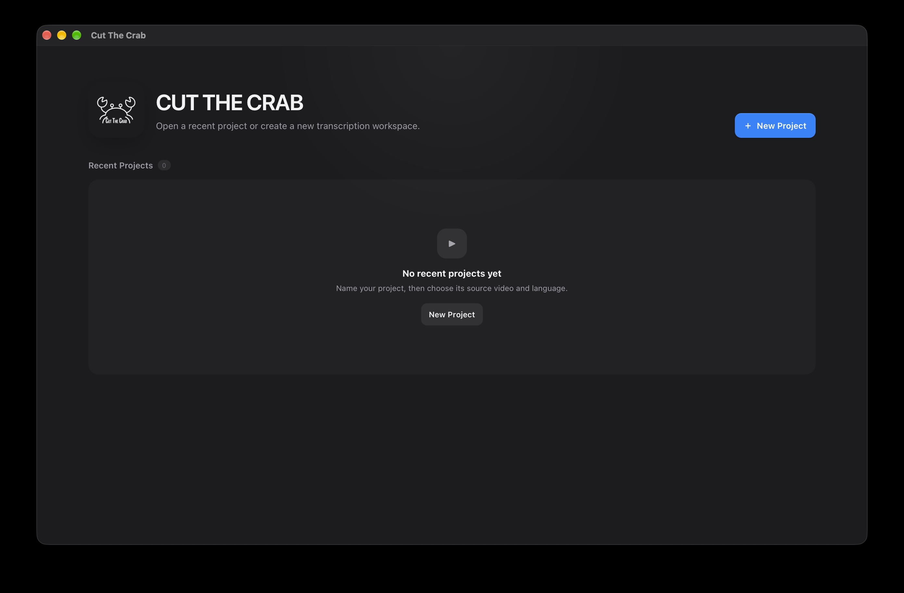

<div align="center">

# Cut The Crab 🦀

**A fast, local-first nonlinear video editor with built-in AI subtitles.**

Cut, caption, and export locally. Your media never needs to be uploaded to a cloud service.

[](https://github.com/Ruined-Elixir/cut-the-crab/releases)
[](#-platform)
[](https://tauri.app)

[Download](https://github.com/Ruined-Elixir/cut-the-crab/releases) · [Features](#-features) · [Build from Source](#-build-from-source) · [Report a Bug](https://github.com/Ruined-Elixir/cut-the-crab/issues)

<div align="center">
  
</div>

---

## Table of Contents

- [Why Cut The Crab?](#-why-cut-the-crab)
- [Features](#-features)
- [Quick Start](#-quick-start)
- [macOS Installation](#-macos-installation)
- [Local AI Transcription](#-local-ai-transcription)
- [Architecture](#-architecture)
- [Platform](#-platform)
- [Build from Source](#-build-from-source)
- [Philosophy](#-philosophy)
- [Status & Roadmap](#-status)
- [Contributing](#-contributing)

---

## 💡 Why Cut The Crab?

Cutting videos, adding subtitles, and producing social or long-form content shouldn't require a huge editing suite. Cut The Crab combines these in one lightweight desktop app:

- 🎬 **Multi-track timeline** with layers, ripple editing, and effects
- 💬 **Subtitles that behave like part of the video**, so they follow every edit
- 🤖 **Local AI transcription** with Whisper and SenseVoice
- 📦 **FFmpeg export** that matches what you see in the preview
- 🔒 **Fully local**: your media never leaves your computer

---

## ✨ Features

| | |
|---|---|
| 🎬 **Nonlinear editing** | Multi-track timeline, blade, ripple, freeze-frame, reverse, speed changes |
| 🖥 **Program Monitor** | Real-time layered preview with drag, resize, and snapping guides |
| 💬 **Subtitle editing** | Multiple tracks, full styling, ASS/libass rendering |
| 🔗 **Linked subtitles** | Captions auto-update when the source video is edited |
| 🤖 **Local transcription** | Whisper and SenseVoice, with no cloud upload |
| 🔊 **Audio** | Waveforms, volume, mute, multi-track mixing |
| 📐 **Flexible formats** | 16:9, vertical short-form, or custom resolutions |
| 💾 **Projects** | Autosave, recent projects, missing-media relink, crash recovery |

<details>
<summary><b>🎬 Nonlinear Video Editing</b></summary>

- Multi-track video timeline with multiple overlapping layers
- Drag-and-drop clip positioning, including across tracks
- Trim start and end points
- Blade / split clips at the playhead
- Cut, copy, paste, duplicate, and delete
- Ripple editing and automatic timeline healing
- Freeze-frame / Hold effect
- Reverse playback and playback-speed adjustments
- Linked video + audio clips
- Frame-accurate scrubbing and timeline zoom
- Automatic edge scrolling while dragging
- Timeline filmstrip thumbnails

</details>

<details>
<summary><b>🖥 Program Monitor</b></summary>

- Real-time preview of the edited timeline, including overlapping layers
- Select videos directly in the preview (layer-aware)
- Drag to reposition and resize inside the preview
- Snapping guides
- Mouse scrubbing preview
- Preview designed to closely match the final export

</details>

<details>
<summary><b>✂️ Ripple & Structural Editing</b></summary>

Cut The Crab understands the relationships between clips instead of treating them as independent objects.

- Insert clips inside existing clips using Ripple
- Automatically split surrounding clips
- Automatically heal clips when inserted sections are removed
- Preserve source timing across edits
- Keep linked subtitles and audio synchronized with video
- Undo structural edits as a single operation

</details>

<details>
<summary><b>💬 Advanced Subtitle Editing</b></summary>

- Dedicated, multiple subtitle tracks visible on the timeline
- Select, drag, and edit individual subtitles
- Move subtitles directly in the Program Monitor
- Timing and text editing
- Font, size, bold / italic / underline, alignment
- Text color, background color, and positioning
- ASS/libass rendering, with previews that match the export
- Adaptive subtitle blocks that stay readable at any zoom level

</details>

<details>
<summary><b>🔗 Video-Linked Subtitles</b></summary>

Generated subtitles stay structurally linked to their source video. When you edit the video, the subtitles update automatically.

**Supported linked operations:** moving, ripple editing, splitting, trimming, deleting, freeze-frame insertion, playback-rate changes, reverse, and automatic timeline healing.

Captions outside the remaining source range are removed. Captions crossing edit boundaries are shortened or split as needed.

</details>

<details>
<summary><b>♻️ Restore Missing Subtitles</b></summary>

Deleted a caption by accident? There's no need to redo everything.

- Retranscribe the original source
- Compare generated captions with existing ones
- Restore missing captions without duplicates
- Map restored captions into the edited timeline
- Preserve nearby subtitle styling where possible

</details>

<details>
<summary><b>🔊 Audio, Waveforms & Caching</b></summary>

- Linked video audio and dedicated audio tracks
- Waveform display, clip volume, and mute controls
- Audio stays in sync through timeline edits
- Multi-track audio mixing on export
- Background generation of waveforms, filmstrip frames, and editing proxies
- Source-aware caching, background retry, limited decoder concurrency
- Proxy cache management and automatic stale-proxy cleanup

> Proxies are used **only** for editing performance. Exports always use the original source media.

</details>

<details>
<summary><b>🎞 Transitions & Effects</b></summary>

- Fade in / fade out
- Dissolve transitions
- Freeze / Hold frames
- Reverse video and playback speed changes
- Adjustment layers
- Layered video compositions

</details>

<details>
<summary><b>📦 FFmpeg-Based Export</b></summary>

- Multi-track video composition and transformations
- Audio mixing, subtitle rendering, transitions, and effects
- Selected-range or full-timeline export
- Custom output resolutions (16:9, vertical, and more)
- Progress reporting and cancellation
- Uses original source media, never proxies

</details>

<details>
<summary><b>💾 Projects, Recovery & Undo/Redo</b></summary>

- Named projects with persistent IDs, rename, and a Recent Projects screen
- Automatic and atomic project saving, plus recovery protection
- Full timeline state preserved (video, audio, subtitles, transforms, effects)
- Missing-media detection and relinking, with duration validation so replacements can't be too short for existing edits
- Project identity is independent of the source filename, so multiple projects can share one source
- Undo/redo for moves, trims, splits, ripple, freeze effects, subtitle edits, and structural changes
- Related video, audio, and subtitle changes are grouped as one logical operation

</details>

<details>
<summary><b>⚡ Playback Optimizations</b></summary>

- Upcoming-clip and near-cut prewarming
- Proxy promotion
- Decoded-frame readiness checking
- Clip-specific decoder identity
- Frame-aware subtitle synchronization
- Controlled background filmstrip decoding
- Media recovery watchdog
- Playback kept in sync with linked audio

</details>

---

## 🚀 Quick Start

1. **Download** the latest release from the [Releases page](https://github.com/Ruined-Elixir/cut-the-crab/releases).
2. **Open** the app and create a new named project.
3. **Import** a video onto the timeline.
4. **Transcribe** to generate subtitles locally.
5. **Edit** the video and subtitles. They stay in sync.
6. **Export** the full timeline or a selected range.

**Workflow:** `Import → Edit → Transcribe → Subtitle → Preview → Export`

---

## 🍎 macOS Installation

Cut The Crab is currently distributed as an **ad-hoc signed, non-notarized macOS app**. Because it is not signed with an Apple Developer ID or notarized by Apple, macOS may block the app the first time you try to open it.

### Install Cut The Crab

1. Download the latest `.dmg` from the [Releases page](https://github.com/Ruined-Elixir/cut-the-crab/releases).
2. Open the `.dmg`.
3. Drag **Cut The Crab** into your **Applications** folder.
4. Open **Cut The Crab** from Applications.

### If macOS blocks the app

If macOS says that the developer cannot be verified or prevents the app from opening:

1. Try to open **Cut The Crab** once.
2. Open **System Settings**.
3. Go to **Privacy & Security**.
4. Scroll down to the **Security** section.
5. Find the message saying that **Cut The Crab** was blocked.
6. Click **Open Anyway**.
7. Confirm by clicking **Open** when macOS asks again.

You should only need to do this the first time you open the app.

> **Why does this happen?**  
> Cut The Crab is currently distributed independently and has not yet been notarized by Apple. The app runs locally on your Mac, and your video files are not uploaded to a cloud service.

> **Security note:** Do not disable Gatekeeper or change system-wide macOS security settings. Use the per-app **Open Anyway** option above.

---

## 🤖 Local AI Transcription

Generate subtitles from imported video without sending it to a cloud service.

| Engine | Models | Notes |
|---|---|---|
| **Whisper** (whisper.cpp) | Base, Small | General-purpose speech recognition |
| **SenseVoice** | Default | Optimized for multilingual speech, including Cantonese |

Cut The Crab handles everything automatically:

- Model download, verification, and local storage
- Audio extraction and speech recognition
- Language detection
- Subtitle generation and timeline placement

Models are verified before being stored locally.

---

## 🏗 Architecture

Cut The Crab keeps the core editing workflow on your computer:

- Local video processing and FFmpeg rendering
- Local AI transcription
- Local project storage
- Local proxy and waveform generation
- No video upload required

### Built With

| Layer | Technology |
|---|---|
| App shell | [Tauri 2](https://tauri.app) |
| UI | React + TypeScript |
| Backend | Rust |
| Media | FFmpeg |
| Transcription | Whisper.cpp, SenseVoice |
| Subtitle rendering | libass (WebAssembly) |

---

## 🍎 Platform

Cut The Crab **v1.0 currently supports macOS on Apple Silicon (M1 or newer).** The app bundles the native tools it needs, including FFmpeg, Whisper, and SenseVoice.

---

## 🛠 Build from Source

**Prerequisites:** [Node.js](https://nodejs.org), [Rust](https://rustup.rs), and the [Tauri 2 prerequisites](https://tauri.app/start/prerequisites/) for macOS.

```bash
# Clone the repository
git clone https://github.com/Ruined-Elixir/cut-the-crab.git
cd cut-the-crab

# Install dependencies
npm install

# Run in development
npm run tauri dev

# Create a production build
npm run tauri build
```


---

## 🎯 Philosophy

1. **Editing should feel immediate.**
   Timeline interactions, playback, scrubbing, and trimming stay responsive.

2. **Subtitles should behave like part of the video.**
   When video is moved, trimmed, split, or rippled, its linked subtitles follow.

3. **What you preview is what you export.**
   The Program Monitor and the FFmpeg output share the same timeline, transformation, layering, and subtitle logic.

---

## 📍 Status

**v1.0** delivers a complete desktop editing workflow, from import to export.

- [x] Multi-track timeline and ripple editing
- [x] Local transcription (Whisper, SenseVoice)
- [x] Video-linked subtitles
- [x] FFmpeg export
- [x] Project system with media relinking
### Future

- [ ] Windows support
- [ ] Linux support
- [ ] Additional editing and workflow improvements

---

## 🤝 Contributing

Contributions, issues, and feature requests are welcome. Check the [issues page](https://github.com/Ruined-Elixir/cut-the-crab/issues), or open a pull request.

1. Fork the project
2. Create your branch (`git checkout -b feature/amazing-feature`)
3. Commit your changes (`git commit -m "Add amazing feature"`)
4. Push to the branch (`git push origin feature/amazing-feature`)
5. Open a pull request

---

## 🙏 Acknowledgments

[FFmpeg](https://ffmpeg.org) · [whisper.cpp](https://github.com/ggerganov/whisper.cpp) · [SenseVoice](https://github.com/FunAudioLLM/SenseVoice) · [libass](https://github.com/libass/libass) · [Tauri](https://tauri.app)

<div align="center">

Made with 🦀 and a lot of cuts.

</div>